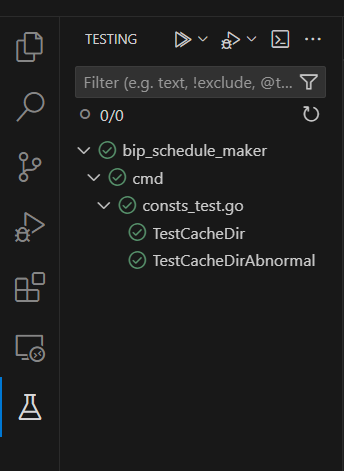

# B社各作業勤務表ジェネレータ

* 発注情報が記載されたxlsx
* 姓, 姓名が記載されたcsv
* 勤務表のテンプレートとなるxlsx

を元に、発注情報に記載の各作業分の勤務表を生成します。
本アプリケーション実行時に、ダイアログで上記のファイルを指定するよう促されます。
sample_assetsディレクトリに、勤務表テンプレートを除き、サンプルを配置してあります。

具体的な各日の勤務時間を記載するシートについては、
土日祝日を避けて、定時想定で記入しています。

全く記入されていない場合は、ネット環境を再確認してみてください。当月の祝日を[API](https://github.com/shogo82148/holidays-jp)で取得しローカルにキャッシュしていますので。

## 開発者向け

### 開発環境構築

Visual Studio Code (以下VSCode)でこのフォルダを開けば、
VSCodeの右下にポップアップが出ますので、その指示に従うと
**ほぼ自動的に**開発環境が整うはずです。

おそらく、下記の順に進むのではないかと思います。
1. WSL Ubuntuのインストール
2. WSL Ubuntu内へのDockerのインストール
3. devcontainerによる開発環境の自動構築

### デバッグ、テスト、リリースビルド

* F5でデバッグ実行。CLIアプリケーションなのでVSCode下部のターミナル上に出力が出ます。開発環境のOSはdebianですので、ファイル選択のダイアログはWindowsで見えるものとは異なります。
* VSCodeの左のフラスコからテストできます。
* `Ctrl + Shift + P`でコマンドパレットを開き、`run test task`などと入力すると最上に表示される`Tasks: Run Test Task`を選択すると、C1カバレッジレポートが`coverage.html`として出力されます。
* Windows用のexeについては、同じくコマンドパレットを開き、`Tasks: Run Build Task`を選択することで、`build`ディレクトリに`exe`が出来上がります。`exe`単体でポータブルに動作します。

### TODO
優先度順。
- [ ] godocの導入
    作成したパッケージの中身が表示されない。cmd -> srcに変更してもダメ。
- [ ] git hooksの導入
- [x] 単体テストのために`ZenityInterface`型を定義したが、テスト時のモック化すれば不要ではないか？要検証
    小規模アプリケーションであるため、グローバル変数とする。
    （大規模であれば、DIコンテナを使うのがよいらしい。）
- [x] 単体テストの充実
- [x] 各作業の勤務表生成を非同期化(現状数秒で完了するので優先度低。主に勉強目的)
- [ ] GUI化。[fyne](https://github.com/fyne-io/fyne)が有望か