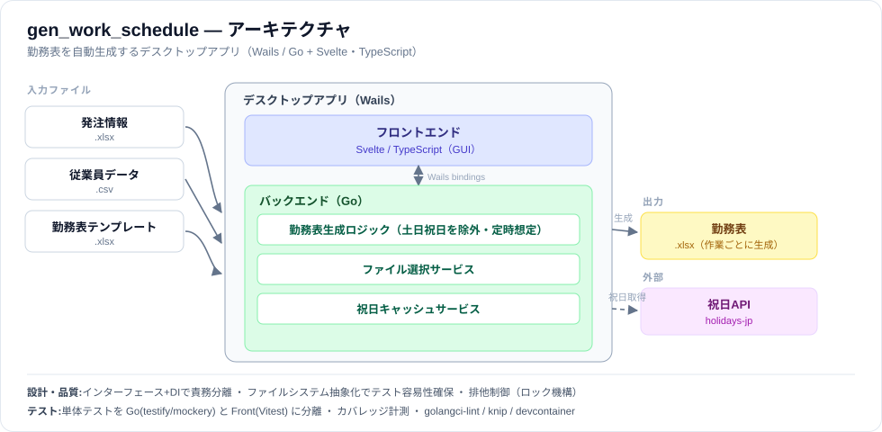
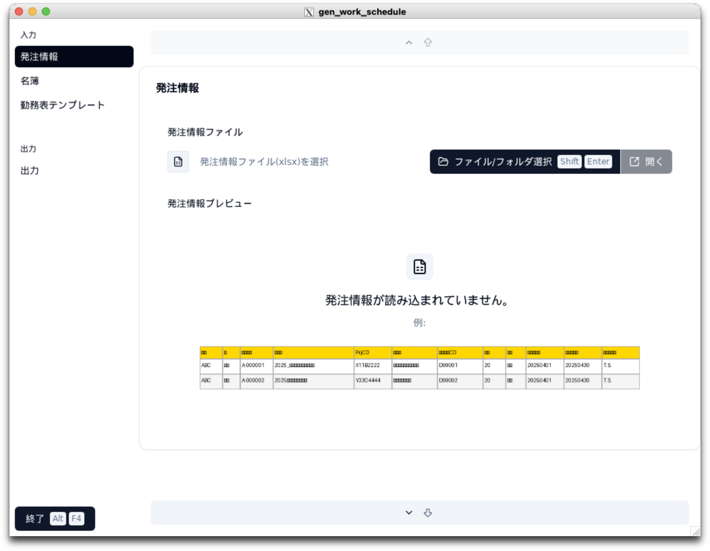

# B社各作業勤務表ジェネレータ

- [B社各作業勤務表ジェネレータ](#b社各作業勤務表ジェネレータ)
  - [概要](#概要)
  - [アーキテクチャ](#アーキテクチャ)
  - [設計・品質面の工夫](#設計品質面の工夫)
  - [開発者向け](#開発者向け)
    - [開発環境構築](#開発環境構築)
    - [デバッグ](#デバッグ)
    - [テスト](#テスト)
    - [Windows向けのリリースビルド](#windows向けのリリースビルド)
  - [開発ツール](#開発ツール)
  - [TODO](#todo)

## 概要

発注情報(xlsx)・従業員データ(csv)・勤務表テンプレート(xlsx)を元に、発注情報に記載の各作業分の勤務表を自動生成するデスクトップアプリです。各勤務日の勤務時間は、土日祝日を避けて定時想定で記入します。祝日は [holidays-jp API](https://github.com/shogo82148/holidays-jp) から取得し、ローカルにキャッシュします。

**技術スタック**: Go（バックエンド） / TypeScript・Svelte（フロントエンド GUI） / Wails（デスクトップ統合） / devcontainer（開発環境）

## アーキテクチャ

## 設計・品質面の工夫

- インターフェースと依存性注入(DI)で責務を分離し、ファイルシステムを抽象化してテスト容易性を確保
- 単体テストをバックエンド(Go / testify・mockery)とフロントエンド(Vitest)に分離し、C1(分岐)カバレッジを計測
- `golangci-lint`・`knip`・`devcontainer` でコード品質と開発環境の再現性を担保
- 排他制御（ロック機構）を実装

* 発注情報が記載されたxlsx
* 姓, 姓名が記載されたcsv
* 勤務表のテンプレートとなるxlsx

を元に、発注情報に記載の各作業分の勤務表を生成します。
`sample_assets`ディレクトリに、勤務表テンプレートを除き、サンプルを配置してあります。

各勤務日の勤務時間を記載するシートについては、
土日祝日を避けて、定時想定で記入しています。

祝日が全く考慮されていないように見える場合は、ネット環境を再確認してみてください。当月の祝日を[API](https://github.com/shogo82148/holidays-jp)で取得しローカルにキャッシュしていますので。

## 開発者向け

### 開発環境構築

Visual Studio Code (以下VSCode)でこのフォルダを開けば、
VSCodeの右下にポップアップが出ますので、その指示に従うと
**ほぼ自動的に**開発環境が整うはずです。

おそらく、下記の順に進むのではないかと思います。
1. WSL Ubuntuのインストール
2. WSL Ubuntu内へのDockerのインストール
3. devcontainerによる開発環境の自動構築

### デバッグ

F5でデバッグ実行。開発環境のOSはdebianですので、ファイル選択のダイアログはWindowsで見えるものとは異なります。

### テスト

* VSCodeの左のフラスコから単体テストできます。
    
    

* バックエンド(Go)とフロントエンド(Vitest)に分かれています。フロントエンドの単体テストではブラウザが開きます。

* カバレッジについては、

    * バックエンドは、下記によって`cmd`フォルダ以下にカバレッジレポートが`html`形式で出力されます。
    
        1. `Ctrl + Shift + P`でコマンドパレットを開き、
        1. `Tasks: Run Task`を選択
        1. `Generate Go Branch Coverage(C1) Report`を選択

    * フロントエンドは、単体テストと同時に`frontend/coverage`フォルダにカバレッジレポートが`html`形式で出力されます。**実行タイミングにより偽陽性となることがありますが、そのケースについては再実行を試みてください。**

### Windows向けのリリースビルド

Windows用のexeについては、下記によって`build/bin/gen_work_schedule.exe`が作成されます。`exe`単体でポータブルに動作します。

1. `Ctrl + Shift + P`でコマンドパレットを開き、
1. `Tasks: Run Build Task`を選択

## 開発ツール

* `mockery`: 単体テスト向けに自動的にモックを作成する。`.mockery.yml`を参照のこと。

* `knip`: フロントエンドにおいて不要なモジュールを検出する。`knip.config.ts`を参照のこと。**偽陽性**も多いのでモジュールやファイル削除には十分注意すること。

## TODO

優先度順。

- [ ] 作成されるファイル名のシーケンス番号を可変に。現在は1固定。
- [ ] godocの導入
    作成したパッケージの中身が表示されない。cmd -> srcに変更してもダメ。
- [ ] git hooksの導入
- [x] 単体テストの充実
- [x] 各作業の勤務表生成を非同期化(現状数秒で完了するので優先度低。主に勉強目的)
- [x] GUI化。
